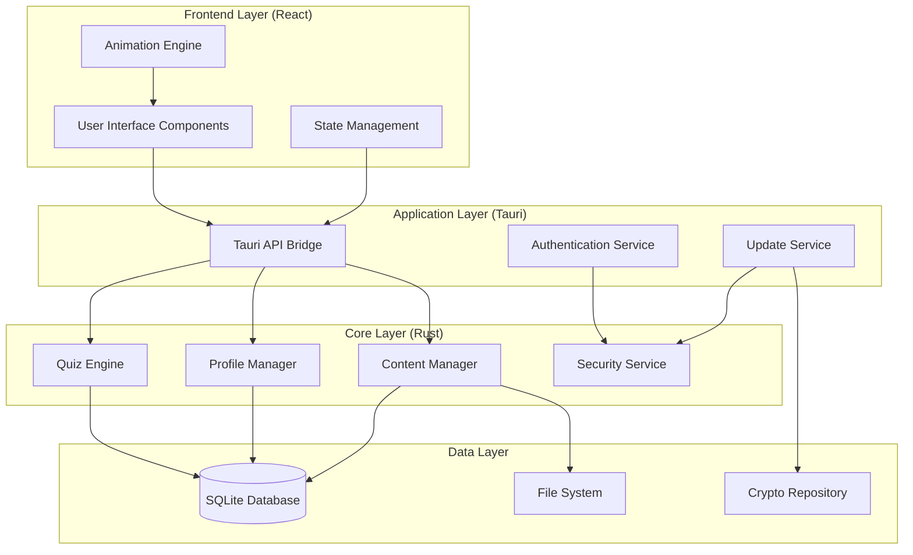

# Design Document

## Overview

The Educational Quiz Application is a cross-platform desktop application built with Tauri (Rust backend) and React (frontend) that provides an engaging, offline-first learning experience for Key Stage 1 and 2 children. The application emphasizes privacy, security, and child-friendly design while delivering curriculum-aligned educational content through interactive quizzes and activities.

## Architecture

### High-Level Architecture



### Technology Stack

- **Frontend**: React 18+ with TypeScript for type safety
- **Backend**: Rust with Tauri framework for native performance
- **Database**: SQLite with rusqlite for Rust integration
- **Animations**: Lottie for complex animations, CSS animations for simple interactions
- **State Management**: React Context API with useReducer for complex state
- **Styling**: CSS Modules with CSS custom properties for theming

## Components and Interfaces

### Frontend Components

#### Core UI Components
```typescript
// Component hierarchy
AppShell
├── NavigationBar
├── UserProfileSelector
├── MainContent
│   ├── SubjectGrid
│   ├── QuizInterface
│   │   ├── QuestionRenderer
│   │   ├── AnswerInput
│   │   └── ProgressIndicator
│   ├── ResultsScreen
│   └── SettingsPanel
└── ParentalGate
```

#### Question Type Components
- `MultipleChoiceQuestion`: Renders options with images and text
- `DragDropQuestion`: Interactive drag-and-drop interface
- `HotspotQuestion`: Clickable image areas with coordinate detection
- `FillInBlankQuestion`: Text input with validation
- `StoryQuizQuestion`: Story display with comprehension questions

#### Animation Components
- `RewardAnimation`: Lottie-based success animations
- `ProgressAnimation`: Visual progress indicators
- `TransitionWrapper`: Page transition animations

### Backend Services (Rust)

#### Quiz Engine
```rust
pub struct QuizEngine {
    db_connection: Arc<Mutex<Connection>>,
    randomizer: QuestionRandomizer,
    timer: QuizTimer,
}

impl QuizEngine {
    pub fn get_questions(&self, subject: Subject, key_stage: KeyStage, count: usize) -> Vec<Question>
    pub fn validate_answer(&self, question_id: u32, answer: Answer) -> AnswerResult
    pub fn calculate_score(&self, quiz_session: &QuizSession) -> Score
}
```

#### Profile Manager
```rust
pub struct ProfileManager {
    db_connection: Arc<Mutex<Connection>>,
    crypto_service: CryptoService,
}

impl ProfileManager {
    pub fn create_profile(&self, name: String, avatar: Avatar) -> Result<Profile>
    pub fn get_progress(&self, profile_id: u32) -> Progress
    pub fn update_progress(&self, profile_id: u32, quiz_result: QuizResult) -> Result<()>
}
```

#### Content Manager
```rust
pub struct ContentManager {
    db_connection: Arc<Mutex<Connection>>,
    file_system: FileSystemService,
}

impl ContentManager {
    pub fn load_content_pack(&self, pack_path: PathBuf) -> Result<()>
    pub fn verify_content_signature(&self, pack: &ContentPack) -> Result<bool>
    pub fn get_subjects(&self) -> Vec<Subject>
}
```

#### Security Service
```rust
pub struct SecurityService {
    key_store: KeyStore,
    signature_verifier: SignatureVerifier,
}

impl SecurityService {
    pub fn verify_update_signature(&self, update_data: &[u8], signature: &[u8]) -> Result<bool>
    pub fn encrypt_sensitive_data(&self, data: &[u8]) -> Result<Vec<u8>>
    pub fn validate_parental_access(&self, input: &str) -> Result<bool>
}
```

### Tauri API Bridge

```typescript
// Frontend API interface
interface TauriAPI {
  // Quiz operations
  getQuestions(subject: string, keyStage: string, count: number): Promise<Question[]>
  submitAnswer(questionId: number, answer: Answer): Promise<AnswerResult>
  
  // Profile operations
  createProfile(name: string, avatar: string): Promise<Profile>
  getProfiles(): Promise<Profile[]>
  getProgress(profileId: number): Promise<Progress>
  
  // Content operations
  getSubjects(): Promise<Subject[]>
  createCustomMix(config: MixConfig): Promise<Mix>
  
  // Update operations
  checkForUpdates(): Promise<UpdateInfo>
  downloadUpdate(updateId: string): Promise<void>
  
  // Settings
  updateTheme(theme: Theme): Promise<void>
  validateParentalAccess(input: string): Promise<boolean>
}
```

## Data Models

### Database Schema

```sql
-- User profiles and progress
CREATE TABLE profiles (
    id INTEGER PRIMARY KEY AUTOINCREMENT,
    name TEXT NOT NULL,
    avatar TEXT NOT NULL,
    created_at DATETIME DEFAULT CURRENT_TIMESTAMP,
    theme_preference TEXT DEFAULT 'default'
);

CREATE TABLE progress (
    id INTEGER PRIMARY KEY AUTOINCREMENT,
    profile_id INTEGER REFERENCES profiles(id),
    subject TEXT NOT NULL,
    key_stage TEXT NOT NULL,
    questions_answered INTEGER DEFAULT 0,
    correct_answers INTEGER DEFAULT 0,
    total_time_spent INTEGER DEFAULT 0,
    last_activity DATETIME DEFAULT CURRENT_TIMESTAMP
);

-- Content structure
CREATE TABLE subjects (
    id INTEGER PRIMARY KEY AUTOINCREMENT,
    name TEXT NOT NULL,
    display_name TEXT NOT NULL,
    icon_path TEXT,
    color_scheme TEXT
);

CREATE TABLE questions (
    id INTEGER PRIMARY KEY AUTOINCREMENT,
    subject_id INTEGER REFERENCES subjects(id),
    key_stage TEXT NOT NULL,
    question_type TEXT NOT NULL,
    content TEXT NOT NULL, -- JSON blob
    correct_answer TEXT NOT NULL,
    difficulty_level INTEGER DEFAULT 1,
    tags TEXT -- JSON array
);

CREATE TABLE assets (
    id INTEGER PRIMARY KEY AUTOINCREMENT,
    question_id INTEGER REFERENCES questions(id),
    asset_type TEXT NOT NULL, -- 'image', 'audio', 'animation'
    file_path TEXT NOT NULL,
    alt_text TEXT
);

-- Custom mixes
CREATE TABLE custom_mixes (
    id INTEGER PRIMARY KEY AUTOINCREMENT,
    name TEXT NOT NULL,
    created_by INTEGER REFERENCES profiles(id),
    config TEXT NOT NULL, -- JSON configuration
    created_at DATETIME DEFAULT CURRENT_TIMESTAMP
);

-- Quiz sessions and results
CREATE TABLE quiz_sessions (
    id INTEGER PRIMARY KEY AUTOINCREMENT,
    profile_id INTEGER REFERENCES profiles(id),
    mix_id INTEGER REFERENCES custom_mixes(id),
    started_at DATETIME DEFAULT CURRENT_TIMESTAMP,
    completed_at DATETIME,
    total_questions INTEGER,
    correct_answers INTEGER,
    time_spent INTEGER
);
```

### TypeScript Interfaces

```typescript
interface Question {
  id: number
  type: 'multiple_choice' | 'drag_drop' | 'hotspot' | 'fill_blank' | 'story_quiz'
  subject: string
  keyStage: 'KS1' | 'KS2'
  content: QuestionContent
  correctAnswer: Answer
  assets?: Asset[]
  difficultyLevel: number
  tags: string[]
}

interface QuestionContent {
  text: string
  options?: string[]
  story?: string
  imageUrl?: string
  hotspots?: Coordinate[]
  blanks?: BlankConfig[]
}

interface Profile {
  id: number
  name: string
  avatar: string
  themePreference: string
  progress: Progress
}

interface Progress {
  subjectProgress: Record<string, SubjectProgress>
  totalQuestionsAnswered: number
  totalCorrectAnswers: number
  achievements: Achievement[]
  streaks: Streak[]
}

interface CustomMix {
  id: number
  name: string
  subjects: string[]
  keyStages: string[]
  questionCount: number
  timeLimit?: number
  difficultyRange: [number, number]
}
```

## Error Handling

### Frontend Error Boundaries
- Global error boundary to catch React component errors
- Quiz-specific error boundary to handle question rendering failures
- Network error handling for update operations
- Graceful degradation when animations fail to load

### Backend Error Handling
```rust
#[derive(Debug, thiserror::Error)]
pub enum AppError {
    #[error("Database error: {0}")]
    Database(#[from] rusqlite::Error),
    
    #[error("Content verification failed: {0}")]
    ContentVerification(String),
    
    #[error("Profile not found: {id}")]
    ProfileNotFound { id: u32 },
    
    #[error("Invalid question format: {0}")]
    InvalidQuestion(String),
    
    #[error("Update download failed: {0}")]
    UpdateFailed(String),
}

impl From<AppError> for String {
    fn from(error: AppError) -> Self {
        error.to_string()
    }
}
```

### Error Recovery Strategies
- Automatic retry for transient network errors during updates
- Fallback to cached content when new content fails to load
- Profile data backup and recovery mechanisms
- Graceful handling of corrupted question data

## Testing Strategy

### Unit Testing
- **Frontend**: Jest + React Testing Library for component testing
- **Backend**: Rust's built-in test framework with mock database
- **Integration**: Tauri's test utilities for API bridge testing

### Test Categories

#### Frontend Tests
```typescript
// Component testing example
describe('QuestionRenderer', () => {
  it('renders multiple choice questions correctly', () => {
    const question = createMockQuestion('multiple_choice')
    render(<QuestionRenderer question={question} onAnswer={jest.fn()} />)
    expect(screen.getByText(question.content.text)).toBeInTheDocument()
  })
  
  it('handles answer submission', async () => {
    const onAnswer = jest.fn()
    const question = createMockQuestion('multiple_choice')
    render(<QuestionRenderer question={question} onAnswer={onAnswer} />)
    
    fireEvent.click(screen.getByText(question.content.options[0]))
    expect(onAnswer).toHaveBeenCalledWith(question.content.options[0])
  })
})
```

#### Backend Tests
```rust
#[cfg(test)]
mod tests {
    use super::*;
    
    #[test]
    fn test_quiz_engine_randomization() {
        let engine = QuizEngine::new_with_mock_db();
        let questions1 = engine.get_questions(Subject::Math, KeyStage::KS1, 10);
        let questions2 = engine.get_questions(Subject::Math, KeyStage::KS1, 10);
        
        // Questions should be in different order
        assert_ne!(questions1, questions2);
    }
    
    #[test]
    fn test_content_signature_verification() {
        let security_service = SecurityService::new_with_test_keys();
        let valid_content = create_signed_test_content();
        
        assert!(security_service.verify_update_signature(
            &valid_content.data, 
            &valid_content.signature
        ).unwrap());
    }
}
```

### Performance Testing
- Quiz loading time benchmarks (target: <500ms)
- Animation frame rate monitoring (target: 60fps)
- Database query performance testing
- Memory usage profiling for long quiz sessions

### Security Testing
- Content signature verification testing
- Parental gate bypass attempt testing
- Local data encryption validation
- Update mechanism security audit

### Accessibility Testing
- Screen reader compatibility testing
- Keyboard navigation testing
- Color contrast validation
- Font size and readability testing

### User Experience Testing
- Child usability testing with target age groups
- Parent feedback on control interfaces
- Performance testing on lower-end devices
- Cross-platform consistency validation